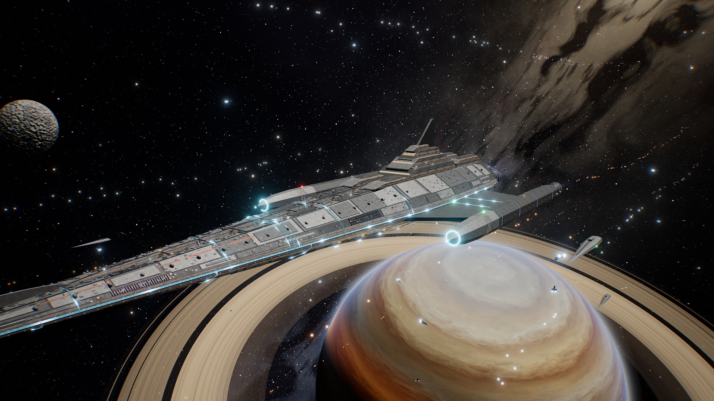

# VESPERA — Capital Starship

A real-time, explorable 3D capital starship rendered in the browser with WebGL (three.js).

VESPERA is the flagship of the Outer Reach: a 5.8 km dagger of layered armour, glowing seams and
machinery, with 86,400 souls aboard. She holds high orbit over the ringed gas giant Aurelis, under a
sky of a hundred and fifty thousand stars, the Milky Way and drifting nebulae.



## Run it

It's a static site with no build step. Serve the folder with any static web server, then open it in a modern
desktop browser (Chrome, Edge, Firefox or Safari with WebGL2):

```bash
python3 -m http.server 8000
```

Then open <http://localhost:8000>.

> Opening `index.html` straight from disk (`file://`) won't work, because browsers block ES modules there.

### Quality

| URL                     | What it does                                                                         |
| ----------------------- | ------------------------------------------------------------------------------------ |
| `?q=high` *(default)*   | 2048² sky, 2K hull textures, 4K shadow map, 4× MSAA, render scale up to 1.5×          |
| `?q=ultra`              | Same as high plus an 8K shadow map, 16× anisotropy and render scale up to 2×          |
| `?q=low`                | Lighter settings for integrated GPUs                                                 |

The **Quality** button cycles the render scale live (0.6× to 2×). The app also lowers the scale
automatically if the frame rate drops well below 30 fps.

## Exploring

| Mode      | Controls                                                                                              |
| --------- | ----------------------------------------------------------------------------------------------------- |
| **Orbit** | Drag to orbit · right-drag to pan · scroll zooms toward the cursor                                    |
| **Fly**   | Click to capture the mouse · `W A S D` move · `R`/`F` up/down · `Q`/`E` roll · `Shift` boost · scroll sets speed |
| **Tour**  | A ten-shot cinematic tour with captions · `Space` next shot · `Esc` leave                              |

Other keys: `1`–`9` jump to points of interest · `L` 3D labels · `H` hide the interface ·
`P` capture a **3840 × 2160** still (also the **Capture 4K** button). Keys `T`, `O` and `V` switch to
Tour, Orbit and Fly.

## The ship

- **Hull**: lofted from 26-point angular cross-sections, sharp at every edge and smooth along the
  length, tapering over four kilometres to a razor prow and a 340 m sensor lance.
- **Layered armour**: two tiers of raised plates in graphite, titanium and near-black, with faintly glowing
  seams in the gaps and a crimson livery stripe toward the prow.
- **Dorsal trench**: a three-kilometre canyon exposing the core. It holds five pulsing energy conduits,
  maglev pods racing between sections, gantry bridges and lit decks on both walls.
- **Reactor heart**: sunk into the trench mid-ship, it turns inside three gyroscopic containment rings.
- **Circulatory network**: arteries of light carry the heart's output over the decks and into the glowing
  channels along each flank, under the keel from channel to channel, and out along the pylons to the
  nacelles. Energy packets visibly flow outward through the whole network.
- **Command tower**: three stepped tiers over the trench, with a panoramic bridge, a cantilevered flag
  bridge, a 240 m sail fin, masts and sensor domes. Stepped superstructure blocks flank it fore and aft.
- **Outboard nacelles**: carried on swept pylons, with cyan intakes and their own drives.
- **Engine array**: thirteen magnetic-nozzle fusion drives with white-hot throats, coil rings, cooling
  ribs and plumes with shock diamonds.
- **Flight operations**: six ventral hangar bays behind atmosphere-retention fields, with chase lights
  leading in.
- **Exposed rib galleries** on the flanks show structure and warm-lit machinery behind the armour.
- **Thousands of lit windows** in deck bands along the flanks, trench walls and tower. They switch on
  and off over time as people move through the ship.

## Feeling alive

- Shuttles cycle through the hangar bays, run to the escorts and depart for the moon Ilex.
- Six traffic lanes carry streams of small craft past the ship in both directions.
- Four escort frigates, 330 m sister ships built from the same hull lines, hold formation alongside.
- Patrol craft orbit the ship, and maintenance drones swarm the tower, bays, nacelles and stern.
- Turrets slowly track along the dorsal shoulders, and the heart's containment rings turn.
- Navigation strobes, red and green running lights and welding arcs flicker across the hull.

## The sky

- **Milky Way and nebulae**: a procedural Milky Way with filamentary dust lanes, a glowing bulge,
  five emission/reflection nebulae and distant galaxies, baked once into a 2048² cubemap.
- **Stars**: about 150,000 point stars with blackbody colours, a power-law brightness distribution and
  diffraction spikes on the brightest, so they stay crisp at any resolution.
- **Aurelis**: a banded gas giant with storms, polar hoods, limb darkening, an atmospheric rim, and
  shadows cast between the planet and its rings.
- **Ilex**: a cratered moon.

## Rendering

- **Lighting**: physically based materials with image-based lighting from the sky and planet, plus a
  directional sun with a shadow map that covers the whole ship.
- **Depth**: a logarithmic depth buffer, so a 1 m detail and a 470 km planet share the scene.
- **Post-processing**: an HDR pipeline (4× MSAA → bloom) and a final grade with occlusion-aware lens
  flare, chromatic aberration, vignette, ACES filmic tone mapping and film grain.
- **No image assets**: every texture (hull plating, window decks, the planet, the rings, the sky) is
  generated procedurally at load time from seeded noise.

## Project layout

```
index.html, styles.css      UI shell
src/main.js                 boot, render loop, capture, automation API (window.VESPERA)
src/world.js                composition: sun, planet, moon, galaxy orientation
src/env/                    sky bake, starfield, sun, planet + rings + moon
src/ship/hull.js            hull loft, armour plates, facet frames
src/ship/capital.js         ship assembly: armour, trench, heart, arteries, tower, nacelles, engines
src/ship/engines.js         engine bells and plumes
src/ship/conduit.js         pulsing conduit and artery shaders
src/ship/materials.js       material library and living windows
src/ship/textures.js        procedural textures
src/life/traffic.js         shuttles, lanes, pods, drones, welding arcs
src/post/post.js            HDR post pipeline
src/ui/                     camera rig (orbit, fly, tour) and HUD
vendor/three/               three.js r187 (MIT)
concepts/                   saved ideas for future versions
```

## 4K stills

The `screenshots/` folder holds 3840 × 2160 renders from the hero viewpoints. To make your own, press
`P` in the app. For scripted renders, load `index.html?still&q=ultra` and call
`window.VESPERA.renderStill(3840, 2160)`, which returns a PNG data URL.
